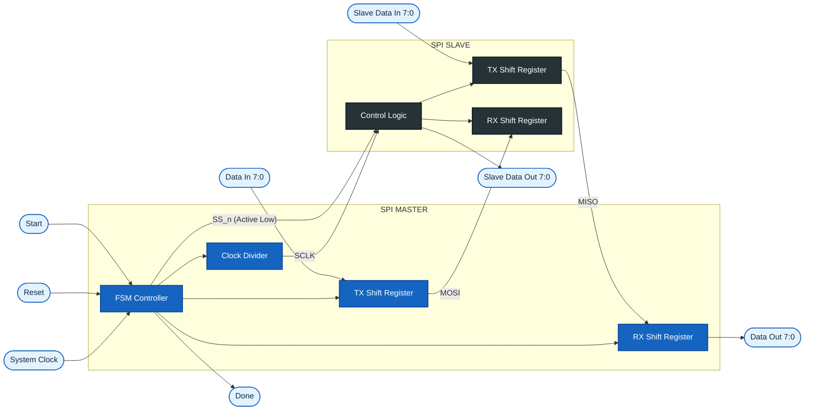

# SPI-Master-Slave-Protocol
SPI Master-Slave in Verilog | 4 Modes, 8-bit Full-Duplex | RTL Design for FPGA

# SPI Master-Slave Logic in Verilog

Serial Peripheral Interface (SPI) Master and Slave implementation in Verilog.
Full-duplex, 8-bit data transfer, MSB first.

## Features
- 4 SPI Modes - Mode 0, 1, 2, 3 (CPOL / CPHA configurable)
- 8-bit data transfer, MSB first
- Configurable clock divider for SCLK generation
- Full-duplex transfer - Master and Slave transmit simultaneously
- Single Slave Select (SS) - easily extendable to multi-slave
- Synthesizable RTL - Simulation verified

## Block Diagram

## Block Diagram

